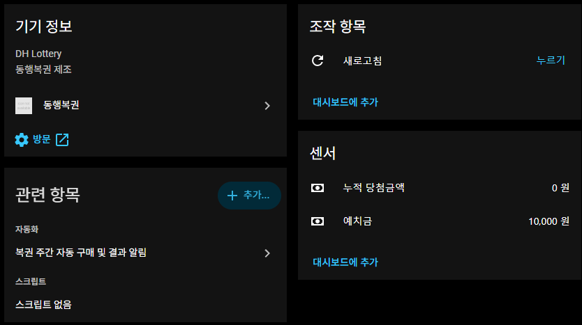
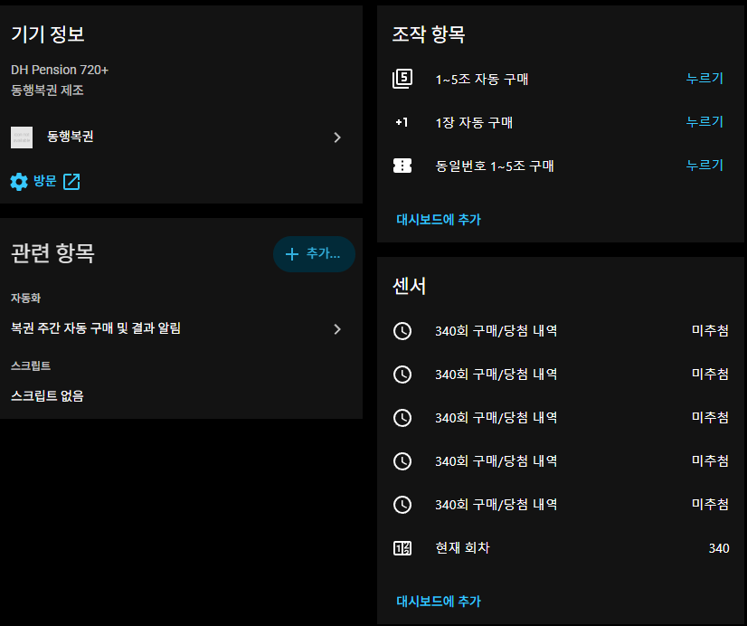
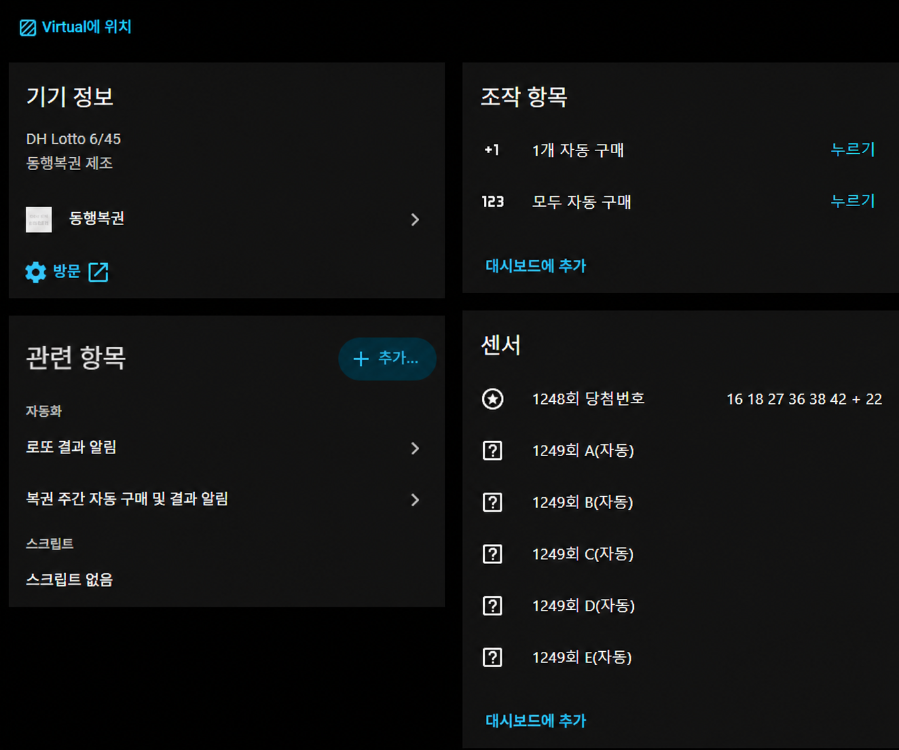

# 동행복권: 로또 6/45 + 연금복권 720+

![HACS][hacs-shield] ![Version][version-shield]

Home Assistant에서 동행복권 계정의 예치금과 구매 내역을 확인하고, 로또 6/45 및 연금복권 720+를 구매할 수 있는 커스텀 통합 구성요소입니다.

> 복권 구매에는 실제 예치금이 사용됩니다. 구매 버튼과 구매 액션을 자동화에 연결할 때는 오작동이나 중복 실행에 주의하세요.

## 주요 기능

- 동행복권 로그인 및 예치금 조회
- 로또 6/45
  - 자동·수동·반자동 구매
  - 최근 구매 번호 및 당첨 결과 조회
  - 1게임 자동 구매, 5게임 자동 구매 버튼
- 연금복권 720+
  - 조별 자동·수동 구매
  - 서버가 배정한 동일번호로 1~5조 세트 구매
  - 현재 판매 회차 조회
  - 최근 구매 5건의 조·번호 및 당첨 결과 조회
  - 1장 자동 구매, 1~5조 자동 구매, 동일번호 1~5조 구매 버튼
- 구매 성공·실패 결과를 Home Assistant 지속 알림으로 표시
- 구매 후 예치금과 구매 내역 자동 갱신

연금복권 구매 내역은 다음처럼 표시됩니다.

- 엔티티 이름: `340회 1조 480289 구매/당첨 내역`
- 상태: `미추첨`, `당첨`, `낙첨` 등
- 속성: `구매 번호`, `구매일`, `구매 수량`, `구매 금액`, `당첨 결과`

`미추첨`은 구매 실패가 아니라 아직 추첨일이 지나지 않았다는 뜻입니다.

## 요구 사항

- 최신 버전의 Home Assistant
- 동행복권 계정
- 복권 구매에 사용할 예치금
- HACS 설치 방식 사용 시 HACS

## 설치

### HACS 사용자 지정 저장소

1. HACS → **Integrations**로 이동합니다.
2. 우측 상단 메뉴에서 **Custom repositories**를 선택합니다.
3. 저장소 주소에 `https://github.com/DopingDeveloper/ha-component-dh-lottery`를 입력합니다.
4. Category는 **Integration**을 선택한 뒤 저장소를 추가합니다.
5. HACS에서 **동행 복권**을 찾아 다운로드합니다.
6. Home Assistant를 재시작합니다.

이미 다른 저장소 주소로 이 통합 구성요소를 설치했다면 기존 통합 등록을 삭제할 필요는 없습니다. HACS에서 기존 사용자 지정 저장소 항목을 제거한 뒤 위 주소를 추가하고, 통합 구성요소를 다시 다운로드한 다음 Home Assistant를 재시작하세요.

### 수동 설치

1. 이 저장소의 **Code → Download ZIP**으로 파일을 내려받습니다.
2. 압축 파일 안의 `custom_components/dh_lottery` 폴더를 Home Assistant의 `/config/custom_components/dh_lottery`로 복사합니다.
3. Home Assistant를 재시작합니다.

업데이트할 때도 같은 폴더를 새 버전으로 교체한 뒤 재시작해야 합니다.

## 통합 구성요소 등록

1. Home Assistant → **설정 → 기기 및 서비스**로 이동합니다.
2. **통합 구성요소 추가**를 누르고 `동행 복권`을 검색합니다.
3. 동행복권 아이디와 비밀번호를 입력합니다.
4. 사용할 복권 종류인 **로또 6/45**, **연금복권 720+**를 선택합니다.

등록이 끝나면 예치금 센서와 선택한 복권의 센서·버튼 엔티티가 생성됩니다.

## 생성되는 주요 엔티티

| 구분 | 엔티티/기능 |
|---|---|
| 공통 | 예치금, 누적 당첨금액, 새로고침 버튼 |
| 로또 6/45 | 최근 당첨번호, 최근 구매 게임 1~5, 1게임 자동 구매, 모두 자동 구매 |
| 연금복권 720+ | 현재 회차, 최근 구매/당첨 내역 1~5, 1장 자동 구매, 1~5조 자동 구매, 동일번호 1~5조 구매 |

실제 엔티티 ID에는 동행복권 아이디가 포함됩니다. 예: `sensor.dh_아이디_deposit`

## 화면 예시

### 동행복권 계정



### 연금복권 720+



### 로또 6/45



> 화면 예시의 로또 구매 번호는 개인정보 보호를 위해 삭제했습니다.

## 액션 사용법

Home Assistant의 **개발자 도구 → 액션**에서 아래 액션을 실행할 수 있습니다. 구매 액션은 응답을 반환하므로 자동화나 스크립트 YAML에서 호출할 때 `response_variable`을 지정합니다.

### 정보 새로고침

```yaml
action: dh_lottery.refresh_lottery
data: {}
```

### 로또 6/45 구매

```yaml
action: dh_lottery.buy_lotto_645
data:
  entity_id: sensor.dh_아이디_deposit
  game_1: 자동
  game_2: 수동, 1, 13, 16, 22, 42, 44
  game_3: 반자동, 3, 4, 5
  game_4: 자동
response_variable: lotto_purchase
```

- 자동: `자동`
- 수동: `수동, 번호1, 번호2, 번호3, 번호4, 번호5, 번호6`
- 반자동: `반자동, 고정번호1, 고정번호2, ...`
- 한 번에 최대 5게임까지 입력할 수 있습니다.

### 연금복권 720+ 조별 구매

```yaml
action: dh_lottery.buy_pension_720
data:
  entity_id: sensor.dh_아이디_deposit
  ticket_1: 자동, 1
  ticket_2: 수동, 2, 123456
response_variable: pension_purchase
```

- 자동: `자동, 조`
- 수동: `수동, 조, 6자리번호`
- 조는 `1`~`5`, 번호는 앞의 0을 포함한 6자리로 입력합니다.
- 한 번에 최대 5장까지 입력할 수 있습니다.

### 연금복권 동일번호 1~5조 구매

```yaml
action: dh_lottery.buy_pension_720
data:
  entity_id: sensor.dh_아이디_deposit
  ticket_1: 동일번호자동
response_variable: pension_purchase
```

`동일번호자동`은 다른 티켓 항목과 함께 사용할 수 없습니다. 동행복권 서버가 하나의 번호를 배정하고 그 번호를 1~5조에 각각 구매하므로 총 5,000원이 사용됩니다.

## 구매 시 주의사항

- 버튼을 한 번 누르면 실제 구매가 진행되고 예치금이 차감됩니다.
- 연금복권 번호가 이미 판매됐거나 구매할 수 없는 경우 해당 번호 구매는 실패합니다.
- 구매 요청 후 `결과가 불명확합니다`라는 메시지가 나오면 **즉시 다시 실행하지 마세요.** 동행복권 웹사이트의 구매 내역에서 실제 구매 여부를 먼저 확인해야 중복 구매를 방지할 수 있습니다.
- 구매 성공 알림에는 회차, 구매 수량, 구매 금액과 실제 구매 번호가 표시됩니다.
- 구매 직후 센서가 갱신되지 않으면 `새로고침` 버튼을 한 번 누르거나 `dh_lottery.refresh_lottery` 액션을 실행하세요.
- 동행복권 사이트 점검 시간, 판매 마감 시간 또는 사이트 API 변경으로 구매·조회가 일시적으로 실패할 수 있습니다.

## 업데이트

HACS에서 새 버전을 다시 다운로드한 후 Home Assistant를 재시작합니다. 브라우저 새로고침만으로는 Python 통합 구성요소의 새 코드가 적용되지 않습니다.

현재 통합 구성요소 버전은 [`custom_components/dh_lottery/manifest.json`](custom_components/dh_lottery/manifest.json)에서 확인할 수 있습니다.

## 문제 해결

문제가 발생하면 다음 정보를 함께 확인하세요.

- 설치된 통합 구성요소 버전
- Home Assistant 로그의 `custom_components.dh_lottery` 오류
- 실행한 버튼 또는 액션 종류
- 구매 실패 알림의 오류 코드와 메시지
- 동행복권 웹사이트 구매 내역의 실제 처리 결과

아이디, 비밀번호, 세션 쿠키 등 민감한 정보는 이슈나 로그에 공개하지 마세요.

## 출처

이 저장소는 다음 공개 프로젝트를 기반 또는 참고하여 제작했습니다.

- [stkang/ha-component-dh-lottery](https://github.com/stkang/ha-component-dh-lottery): Home Assistant 동행복권 커스텀 통합 구성요소의 기반 프로젝트
- [darkhowk/ha-dhlottery](https://github.com/darkhowk/ha-dhlottery): 연금복권 720+ Home Assistant 애드온 및 기능 구현 참고
- [umi-corp/autolotto720](https://github.com/umi-corp/autolotto720): 연금복권 720+ 구매 요청 흐름 참고

각 프로젝트 제작자와 기여자에게 감사드립니다.

[hacs-shield]: https://img.shields.io/badge/HACS-Custom-red.svg
[version-shield]: https://img.shields.io/badge/version-0.3.3-blue.svg
